# 麦门心事 · Maimen Xinshi

**把一句心事读成一顿麦当劳，再让三个陌生人决定这顿吃不吃。**


零依赖 · 单文件 · 静态部署 · 菜单与营养数据取自麦当劳中国 MCP 的真实返回


---

## 这是什么

一个基于**麦当劳中国 MCP Server** 的 Skill：写下今天的心事，Skill 用 `query-meals`、`list-nutrition-foods`、`calculate-price` 等工具把它读成一份能解释得通的餐；点单之后，再交给三个陌生人审你的菜单——加点、扣点、不批，三人审完才定稿。

本仓库是这次参赛作品的完整交付，不只一个页面：

| 组成 | 位置 | 说明 |
|---|---|---|
| Skill 定义 | `SKILL.md` | WorkBuddy / Claude Skill 格式的主指令 |
| MCP 接入说明 | `MCP_INTEGRATION.md` | 实际用到的 Server、Tool、调用流程与业务价值 |
| 演示前端 | `index.html` | 零依赖单文件页面，双击即跑；下面所有截图都出自它 |
| 数据与校验 | `scripts/`、`data/` | MCP 调用封装、营养计算、菜单快照与实时比对 |
| 本地代理 | `server/` | Node 单文件，把 MCP 结果转成页面可读的 JSON |

**目标用户**：一个人点单、又在犹豫“这顿该不该吃”的人——加班到十点、不想被推荐沙拉的人；想点四样、需要有人拦一下的人。

**边界**：只做决策辅助，不调用任何下单类工具。

## 项目背景

点单这件事，很少是“饿了”决定的。三个观察构成了这个项目的起点：

1. **点单是情绪行为。** 加班、被否、吵架之后，人点的东西和平时不是同一份；而现有推荐系统只看“你爱吃什么”，不看“你今天怎么了”。
2. **推荐系统只会加，不会减。** 你选了四样，它就帮你凑到五样；没人会告诉你“这一份太多了”。真正缺的不是更多推荐，是有人拦一下。
3. **没有外部约束，决定撑不过三分钟。** 自己给自己定的“冷静一下”，通常在电梯里就失效了。

所以我们做了两件事：先把心事翻译成一顿能解释得通的饭；再把“该不该吃、吃多少”交给三个不认识你的人。

## 创新点

| 创新点 | 具体做法 | 和常见做法的差别 |
|---|---|---|
| 情绪到餐单的可解释映射 | 8 个情绪标签各有“想要 / 排斥 / 关键词”三维规则，配餐后逐条说明为什么是这几样 | 不是协同过滤的“猜你喜欢”，每一步都能指着规则说明原因 |
| 会做减法的推荐 | 热量超标时先换饮品、再换配餐，且**保留热/冰属性与“想吃炸的”这个意图** | 大多数推荐只做加法，减量时容易把用户真正想要的东西换掉 |
| 审核菜单，而不是审核商品 | 三个陌生人只能做三件事：加点、扣点、不批，全部强制写理由 | 把“理性消费”从购物车搬到餐桌上，且结果是一份可执行的菜单而不只是一个“通过/驳回” |
| 纯 CSS 的 3D 卡片 | `perspective` + `preserve-3d` + 指针驱动的 `rotateX/Y`，用暗板做厚度 | 没有 WebGL、没有 Three.js、没有引入任何库，离线可跑 |
| 真实数据 + 诚实标注 | 22 个品项的价格、热量全部来自 MCP 返回；缺失时显示“暂未获取”并排除在合计外 | 不编数据、不估算填充，页脚写清数据时点 |

## 核心功能

### 1. 心事配餐

输入今天发生了什么，选一个情绪标签（疲惫 / 挫败 / 焦虑 / 孤独 / 委屈 / 兴奋 / 平静 / 奖励自己）、一家门店，生成一份配餐。八个情绪不是装饰——每个都对应一组“想要什么口感、排斥什么、关键词是什么”的规则。

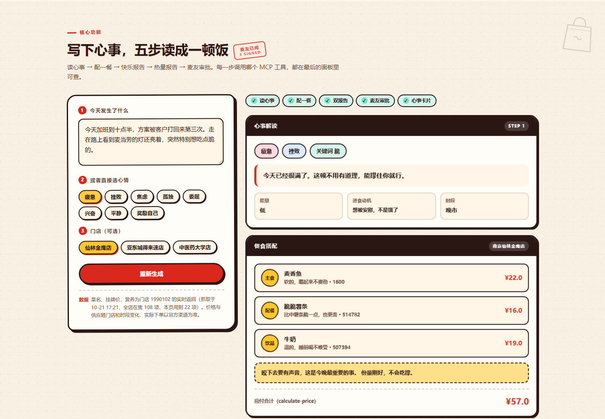

### 2. 双报告与麦友审批

同一顿饭给出两份互不冲突的结论：**快乐报告**看你被满足了多少，**热量报告**看这顿占了多少配额。下面是三位虚拟麦友的表态——有人点头，有人劝你换个饮品，最后汇成一句综合意见。

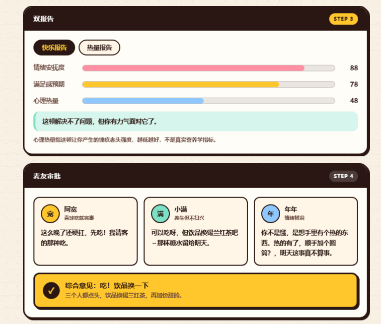

### 3. 心事卡片：会跟着指针转的 3D 卡片

结果面板最后一步是一张实体小票卡。它随指针倾斜，背后有厚度，贴纸挂在不同景深层；可以复制定稿文案、切纯文本版、生成分享链接。整张卡是 CSS 3D，不是图片。

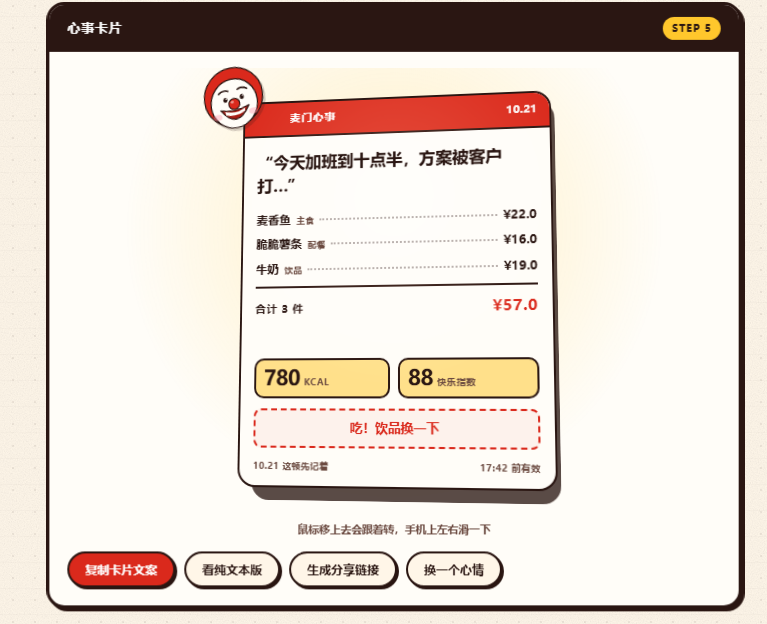

### 4. 想吃点什么 · 先过三个陌生人

这是本项目的主打功能，也是“理性吃饭”落地的地方。

**五步读成一顿饭**：写下心事 → 只能点麦当劳的菜 → 交给三个陌生人 → 三个人各自加点 / 扣点 / 不批 → 菜单定稿。页面顶部有一条五步进度条，跟着你最新的那张单子走。

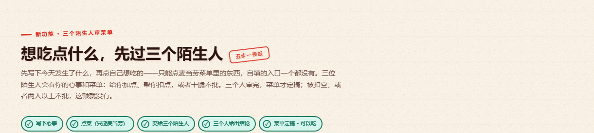

**第一步写心事，第二步点菜，商品是硬限制的。** 页面里没有任何自填商品名的输入框，选品只能点菜单里的 22 个 chip（8 主食 / 7 配餐 / 7 饮品），价格和热量自动带出；一次 1–5 样，选满后其余置灰，留点余量让人扣。

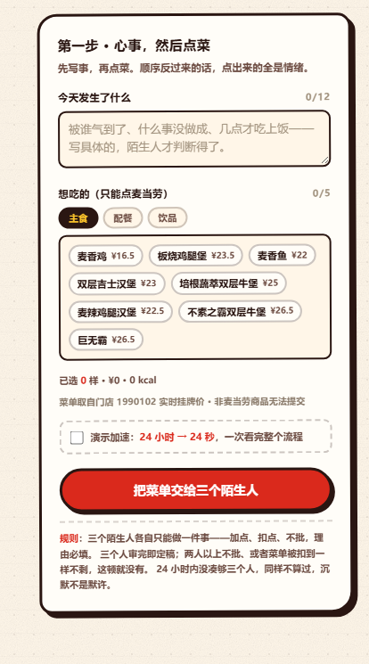

**三个人审完，菜单才定稿。** 审议单上有三格固定座位：谁审了、做了什么动作、加了或扣了哪一样、原话是什么，全部摆在同一行。被扣的那行在原菜单上划掉并标「扣掉」，加进来的标「加点」——一眼看得出这顿饭是怎么被改的。图中上面那张是“不批”的结果，下面那张是“定稿”的结果。

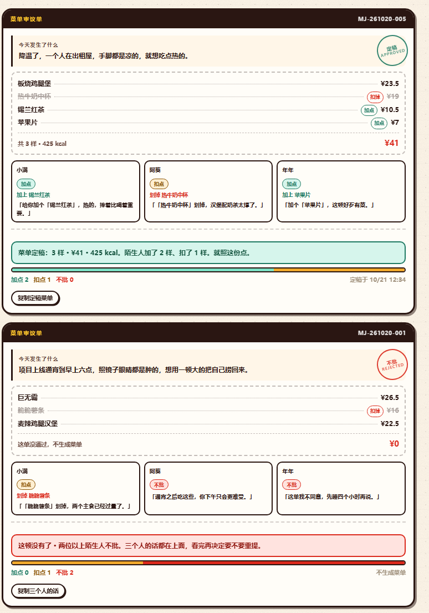

**投票必须选边、必须挑具体菜品、必须写满 6 个字。** 三个动作各有一个按钮：加点（从菜单里给他加一样）、扣点（划掉他点的一样）、不批（整单不同意）。动作和理由矛盾会被拦下——选了不批却写“可以吃”，提交不了。

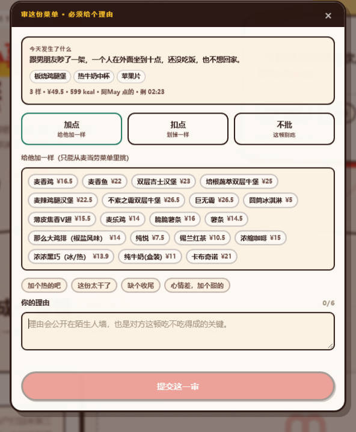

**分发与反馈。** 别人的单子进入待审池，显示心事、菜单、剩余时间和已审人数；审过并结算的单子移入「我审过的」，并标注你那一审和结果一致还是相反。陌生人的原话会留在理由墙上。

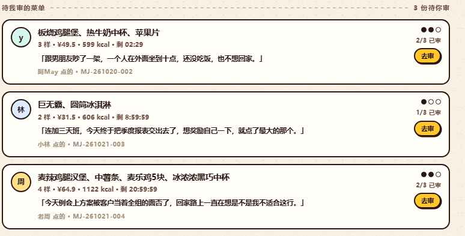

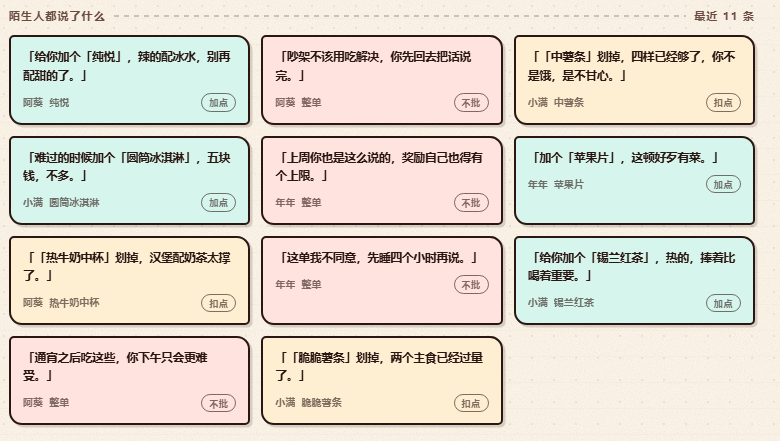

裁决规则只有一条，收在一个纯函数里（`trJudge()`）：三个人全部审完才定稿；**不批 ≥ 2，或菜单被扣到一样不剩 → 这顿没有了；其余 → 菜单定稿，定稿菜单 = 原菜单 − 扣点 + 加点**。24 小时内凑不满三个人则过期，菜单不生效——沉默不是默许。

八个指标收在底部，回答“我被加过什么、被扣过什么”。

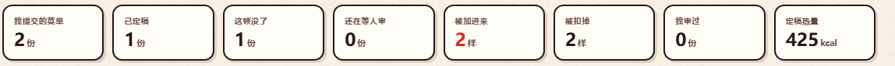

移动端单栏排布，弹层贴底弹出，审议单的三个座位折成两列。

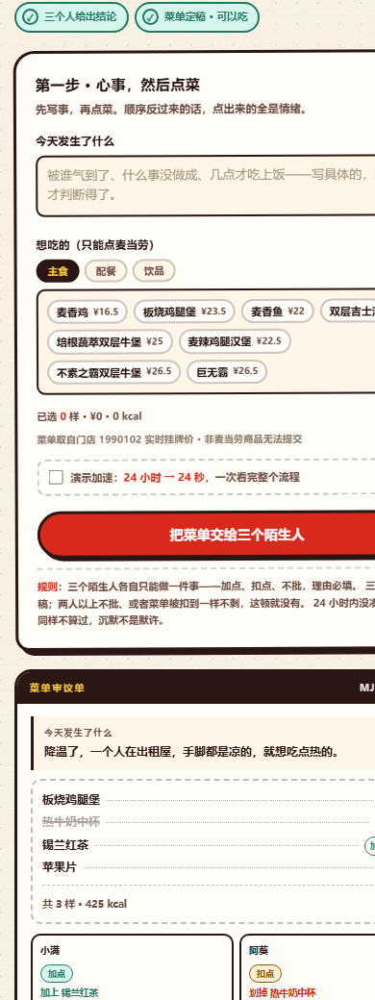
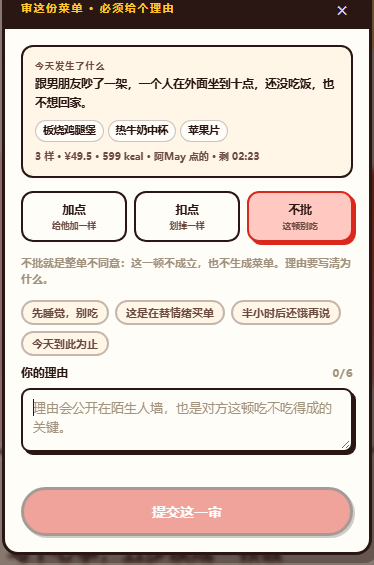

### 5. 今日趣味

星座食运、此刻天气、麦门签。天气会反向影响配餐倾向（下雨推热的、闷热推冰的），星座与签按日期确定性生成——同一天同一星座结果固定，不做随机数糊弄。

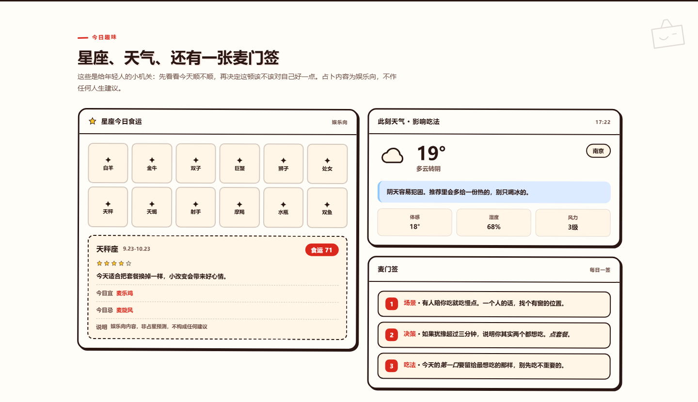

### 6. MCP 接口面板

页面底部列出 8 个真实工具，点开可以看到当时的真实请求参数与返回结构（样例取自实际响应，已裁剪）。

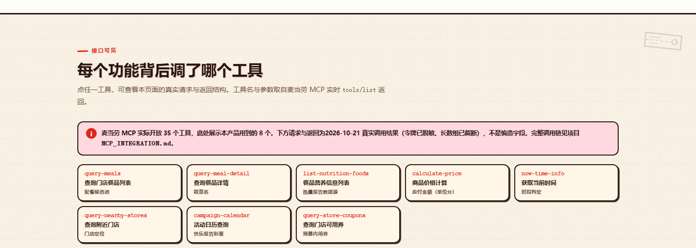

## 快速开始

不需要 `npm install`，不需要 API Key，不需要构建。

```bash
# 方式一：直接打开
# 双击 index.html 即可完整运行（个别浏览器会限制 file:// 下的 localStorage，
# 若陌生人模块无法保存记录，改用方式二）

# 方式二：起一个本地静态服务（推荐）
cd maimen-xinshi
python -m http.server 8765
# 打开 http://localhost:8765

# 方式三：一键演示（自动填入示例心事并跑完五步）
# http://localhost:8765/?demo=1
```

要求：任意现代浏览器（Chrome / Edge / Safari / Firefox 近两年版本）。

## 安装 Skill（在 WorkBuddy 里用）

页面之外，本项目的主体是一个可装载的 Skill。三步：

**1. 申请 MCP Token**：打开 <https://open.mcd.cn/mcp>，手机号登录 → 右上角【控制台】→【激活】，同意协议后复制 Token。

**2. 配置连接器**：WorkBuddy 侧边栏【专家·技能·连接器】→【连接器】→ 右上角【自定义连接器】→【配置 MCP】，填入：

```json
{
  "mcpServers": {
    "mcd-mcp": {
      "type": "streamablehttp",
      "url": "https://mcp.mcd.cn",
      "headers": { "Authorization": "Bearer ${MCD_MCP_TOKEN}" }
    }
  }
}
```

保存后回到【自定义连接器】把 `mcd-mcp` 设为【启用】。

**3. 装载 Skill**：把本仓库放进 `~/.workbuddy/skills/maimen-xinshi/`，重开会话即可；或直接说“用麦门心事帮我配一餐”。

> 不要把真实 Token 写进仓库（参赛声明第三章明确要求）。仓库内所有示例一律用 `${MCD_MCP_TOKEN}` 占位。

不带 Skill、纯命令行也能试：

```bash
# 取一份门店菜单，确认餐品编码
python scripts/mcd_client.py --list-meals --store-code 1990102

# 生成热量报告
python scripts/nutrition.py --items "麦辣鸡腿堡,中薯条,可口可乐(中)"
```

## 使用示例

**场景 A：加班一周，想给自己一顿。**

1. 心事框写“这周连着加班，今天终于把方案交出去了”，选「奖励自己」
2. 生成 → 得到双层吉士汉堡 + 苹果片 + 冰浓浓黑巧中杯，¥43.9 / 596 kcal，配一句“甜是今天唯一不用解释的东西”
3. 快乐报告与热量报告分开看：这顿占了多少配额、钠是否偏高；麦友建议把饮品换成锡兰红茶
4. 想要准确价格就点「应付合计」，走 `calculate-price` 复核逐项计价

**场景 B：想点四样，交给陌生人裁决。**

1. 在「先过三个陌生人」里写下心事，勾四样菜（麦辣鸡腿汉堡、中薯条、麦乐鸡5块、冰浓浓黑巧中杯），点「把菜单交给三个陌生人」
2. 三位陌生人陆续审完：小满扣掉中薯条（“四样已经够了，你不是饿，是不甘心”）、阿葵加上纯悦、你那一票加上苹果片
3. 定稿 5 样、¥64.9、865 kcal——原本的四样变成“一个汉堡 + 麦乐鸡 + 苹果片 + 一杯水 + 一杯甜的”
4. 若其中两人选了「不批」，这张单直接作废，理由会留在陌生人墙上

## 效果演示

现场演示的三条路径：

| 目的 | 操作 | 耗时 |
|---|---|---|
| 看配餐与双报告 | 打开 `?demo=1`，自动填入示例心事并跑完五步 | 约 5 秒 |
| 看陌生人审议闭环 | 提交菜单后勾「演示加速」，三位陌生人按 18% / 42% / 66% 的时间轴陆续开口，第三人到位即定稿 | 约 20 秒 |
| 看别人怎么审 | 待审池里挑一张，走一遍加点 / 扣点 / 不批 | 约 30 秒 |

整页预览（点击查看原图）：

- [桌面端整页](preview-desktop.png)
- [移动端整页](preview-mobile.png)
- [卡片区特写](preview-bench.png)

## 技术方案与架构

```
┌──────────────────────────────────────────────────────────┐
│  数据侧（构建期 / 运行期均可）                            │
│  麦当劳中国 MCP  ──Bearer──▶  代理服务 / Skill / 脚本     │
│  query-meals · calculate-price · list-nutrition-foods …   │
│                    │                                      │
│                    ▼  生成快照（菜名 / 价格 / 营养 / 门店）│
├──────────────────────────────────────────────────────────┤
│  呈现侧（本仓库，纯静态）                                 │
│  index.html                                               │
│   ├─ MEALS 22 项 + STORES 3 家        ← 快照数据          │
│   ├─ EMO_RULES 8 条情绪规则           ← 配餐决策          │
│   ├─ pickMeals() 选餐 / 减量 / 保意图 ← 算法层            │
│   ├─ 陌生人模块  trJudge() 单一裁决   ← 规则层            │
│   └─ 渲染层：面板 / 3D 卡片 / 审议单  ← 视图层            │
└──────────────────────────────────────────────────────────┘
```

**为什么前端不直连 MCP。** MCP 走 `Authorization: Bearer` 鉴权，Token 放进浏览器等于公开泄露，浏览器端另有 CORS 限制。所以正式形态是“后端 / Skill 侧调 MCP → 生成结果 → 前端只负责呈现”，本仓库演示的是后半段，数据是调用后的快照。

**几个关键实现：**

| 模块 | 做法 |
|---|---|
| 配餐 | 情绪规则给出“想要的口感标签”打正分、排斥的标签打负分，再叠加价格、热量预算、时段与天气修正；先选主食，再补配餐与饮品 |
| 减量 | 热量超预算时优先换饮品（保留热/冰），其次换配餐，最后才动主食；换完重新校验“意图标签”是否还在 |
| 陌生人裁决 | `trJudge(case)` 一个纯函数输出 `{加点数, 扣点数, 不批数, 定稿菜单, 金额, 热量, 裁决}`，印章、票型条、结论文案、统计都读它的返回值 |
| 3D 卡片 | `perspective:1100px` + `preserve-3d`，指针偏移映射为 `rotateX ±16°`、`rotateY ±18°`；背面暗板 `translateZ(-16px)` 露出厚度；贴纸挂在 `translateZ(62px)` 做视差 |
| 降级 | `prefers-reduced-motion` 下不绑指针事件、直接铺静止姿态；所有装饰层 `aria-hidden` 且 `pointer-events:none` |

**体积与性能**：单文件约 180 KB，无外链字体、无图标库、无 CSS 框架；首屏无网络请求，`file://` 直接可跑。

**落地边界**（评审关心"能不能真跑"，这里写清楚哪些是演示、哪些要补）：

| 项 | 演示现状 | 上线需补 |
|---|---|---|
| 分发 | 本地种子数据 + 模拟陌生人按时间轴开口 | 服务端任务队列，按活跃度把单子推给三位真人 |
| 计票 | 单浏览器内计数 | 服务端计票 + 用户 ID 去重，一人一单一次 |
| 菜名与价格 | 页面内置 MCP 快照 | 提交时用 `query-meals` 复核编码与挂牌价，防过期价 |
| 防串通 | 无 | 投票人匿名、限制同一对用户互审频次、异常票型识别 |
| 不可篡改 | 无 | 结算写入带时间戳签名，理由不可事后编辑 |

## 目录结构

```
maimen-xinshi/
├── README.md                 # 本文件
├── SKILL.md                  # Skill 主指令（WorkBuddy / Claude Skill 格式）
├── CONTEST_DECLARATION.md    # 官方参赛声明，原文未改动
├── MCP_INTEGRATION.md        # MCP 接入说明：Server / Tool / 调用流程 / 业务价值
├── workbuddy.md              # 使用 WorkBuddy 开发的对话上下文
│
├── index.html                # 演示前端：HTML + CSS + JS 单文件（零依赖）
├── docs/images/              # README 截图（15 张）
├── preview-*.png             # 桌面 / 移动 / 卡片区整页预览
├── verify_page.js            # 自检：语法、数据一致性、卡片等宽、8 情绪端到端
├── test_trial.js             # 「先过三个陌生人」E2E（67 项断言）
│
├── scripts/
│   ├── mcd_client.py         # MCP 调用封装（streamable HTTP）
│   ├── nutrition.py          # 热量报告计算
│   ├── card.py               # 心事卡片生成
│   └── check_snapshot.py     # 快照 vs 实时数据三维比对
├── data/
│   ├── emotions.yaml         # 情绪 → 口味偏好映射
│   ├── mayou.yaml            # 三位虚拟麦友的人设与话术
│   └── snapshot/             # 门店菜单与营养快照（2026-10-21）
├── examples/
│   └── sample_session.md     # 一次完整会话示例
└── server/                   # 本地 MCP 代理服务（Node 单文件）
    ├── server.js
    └── start.bat
```

## 技术栈

| 层 | 选型 | 说明 |
|---|---|---|
| 页面 | 原生 HTML + CSS + JavaScript（ES5 语法） | 不使用框架与打包器，双击即跑 |
| 样式 | 手写 CSS，CSS 自定义属性 + Grid/Flex | 手绘拼贴风：纸张肌理、撕纸边、胶带、套准十字 |
| 3D | CSS 3D Transform | 无 WebGL、无 Three.js |
| 存储 | `localStorage`（键 `maimen.trial.v2`） | 陌生人模块的审议单与投票本地持久化 |
| 数据 | 麦当劳中国 MCP（Streamable HTTP + Bearer） | 菜单、价格、营养、门店、时段 |
| 测试 | Node.js 脚本 + 无头 Edge | 虚拟时间驱动，无需人工点击 |

## 部署与运行

| 场景 | 做法 |
|---|---|
| 静态托管 | 把整个 `maimen-xinshi-web/` 目录丢到 GitHub Pages / Netlify / Vercel / 任意对象存储即可，无需服务端 |
| GitHub Pages | Settings → Pages → Source 选分支目录，访问 `https://<user>.github.io/<repo>/` |
| 内网演示 | `python -m http.server 8765`，手机与电脑同网段可直接访问 |
| 接入实时数据 | 用 `server/server.js` 起代理（默认 `1990102` 门店），把 `MEALS` 换成实时返回 |

注意：**不要把 MCP Token 写进前端**。本仓库前端不发起任何需要鉴权的请求。

## 数据说明

页面数据全部来自麦当劳中国 MCP 的真实返回，但它是「调用后的快照」，不是浏览器里的实时请求。

| 数据 | 真实来源 | 本页现状 |
|---|---|---|
| 菜单、餐品编码、菜名、挂牌价 | `query-meals`（门店 1990102 · 南京仙林金鹰） | 22 个品项，取自 111 项全量菜单 |
| 价格校验 | `calculate-price` | 逐项计价结果，与挂牌价交叉核对一致 |
| 营养数值（热量 / 蛋白 / 脂肪 / 碳水 / 钠） | `list-nutrition-foods` | 160 行营养库，按菜名精确匹配 |
| 门店列表 | `query-nearby-stores` | 南京 5 家真实门店与编码，页面展示 3 家 |
| 时段判定 | `now-time-info` | 浏览器本地时间（与 MCP 返回日期一致） |
| 活动日历 | `campaign-calendar` | 未接入，页面不展示倒计时类信息 |
| 天气、星座、麦门签 | 非 MCP 能力 | 按日期确定性生成，页面已标注为趣味内容 |

刻意的诚实设计：营养数据缺失时显示「暂未获取」并排除在合计之外，不做估算填充；页脚写明数据时点；实际以下单时麦当劳官方渠道为准。

## 测试与评测

三个脚本可复现，证明页面上的数字不是编的。

```bash
# 0. 先起静态服务：E2E 用无头浏览器从这里加载页面
python -m http.server 8765

# 1. 页面自检：语法、22 项 vs 快照、卡片等宽、8 种情绪端到端
node verify_page.js

# 2. 陌生人模块 E2E：67 项断言
node test_trial.js

# 3. 快照 vs MCP 实时数据：在售状态、价格、热量三维比对
set MCD_MCP_TOKEN=<your-token>
cd scripts && python check_snapshot.py
```

`verify_page.js` 覆盖：脚本语法、22 个品项与快照一致、三张卡片等宽、8 种情绪的端到端（价格合计、热量合计、理由与餐食自洽）。

`test_trial.js` 用无头 Edge 的虚拟时间驱动，覆盖：

| 组 | 断言内容 |
|---|---|
| 初始渲染 | 我的审议单 2 份、待审池 3 份、五步条、三个座位、历史定稿的金额热量 |
| 商品硬限制 | 不存在自填商品 / 价格输入框、三个分类合计 22 项、编码格式合法 |
| 表单校验 | 空表单拦截并定位到出错栏位、5 样上限、选满后其余置灰 |
| 提交 | 生成审议单、24 秒倒计时（加速模式）、表单清空、步骤条推进到第 4 步 |
| 投票门禁 | 未选动作 / 未挑菜品 / 理由不足 6 字均禁用；动作与理由矛盾被拦 |
| 裁决 | 加点扣点的菜单演算、金额热量核对（¥64.9 / 865 kcal）、两人不批即否 |
| 反馈 | 审议后离开待审池、进入「我审过的」、与结果一致性的标注 |
| 其他 | 撤回、重置、统计格数 |

最近一次结果（2026-10-21）：

- `check_snapshot.py` 核对的 6 个工具均真实返回，111 项餐品全部在售，营养数据零变动；
- 页面 22 项与实时挂牌价逐项一致；
- 8 种情绪端到端全部通过；
- 陌生人模块 67 项断言全部通过；
- 1440 / 390 两种宽度下逐组件量过 `scrollWidth === clientWidth`，无横向溢出。

## 常见问题

**Q：为什么不能自己输入想吃的菜？**
A：这是刻意的限制。能自填就能写“一份炸鸡”，那审核就没有边界了。菜单来自门店真实挂牌数据，价格与热量才有依据。

**Q：三个陌生人是真人吗？**
A：演示版是本地模拟器（`trBotVotes()` 按时间轴生成立场），真实产品必须由服务端把单子分发给三位真人，并做用户去重与防刷。要补的五项见「技术方案与架构 · 落地边界」。

**Q：票数够了为什么不立刻给结果？**
A：给。现在的规则就是「三个人审完即定稿」，不用等满 24 小时，24 小时只是等人到齐的上限。早前的购物冷静期版本要求"票够也要等满 24 小时"，两者都成立，区别在于约束的是时间还是人——审核菜单时，人比时间重要。

**Q：可以直接商用吗？**
A：不可以。这是参赛作品，非麦当劳官方产品，商标与菜单数据归麦当劳中国所有。

**Q：手机上怎么演示？**
A：`python -m http.server` 起服务后，手机访问 `http://<电脑内网IP>:8765/?demo=1`，加速模式下一个完整审议闭环约 20 秒。

## 贡献指引

欢迎提 Issue 讨论规则与文案，提 PR 前请确认：

1. 改动 `index.html` 后跑 `node verify_page.js` 与 `node test_trial.js`，两者都必须全绿；
2. 新增菜品只能来自 MCP 返回，不要手写价格与营养；新品类需要同时补 `cat` 与营养字段；
3. 新增情绪标签要在 `EMO_RULES` 里补齐 `want / ban / kw` 三维，否则配餐会退回默认规则；
4. 改动陌生人模块的裁决逻辑，只能动 `trJudge()`，不要在其他地方另写一套判断；
5. 截图请放在 `docs/images/`，命名用小写短横线（例：`trial-form.png`）。

代码风格：原生 ES5 语法（不用箭头函数与模板字符串），CSS 变量统一走文件顶部定义，注释用中文、写“为什么”而不是“是什么”。

## 团队与致谢

**参赛形式**：个人参赛（1 人），独立完成产品设计、前端实现、数据接入与测试。

| 角色 | 负责内容 |
|---|---|
| 产品 | 情绪分类与规则设计、陌生人模块的裁决规则、文案与视觉方向 |
| 前端 | 单文件页面实现、手绘拼贴视觉、CSS 3D 卡片、响应式与无障碍 |
| 数据 | MCP 工具接入、菜单与营养快照、价格交叉校验 |
| 测试 | 端到端脚本、逐宽度布局量测、数据一致性比对 |

**致谢**：

- 麦当劳中国 MCP 提供菜单、价格、营养与门店数据；
- 麦当劳程序员节创意开发大赛提供命题与展示机会；
- 视觉上参考了丝网印刷与 zine 拼贴的排版语言，“先过三个陌生人”的产品逻辑参考了「钱包请等等」的冷静期思路。

## 声明

本项目为麦当劳程序员节创意开发大赛参赛作品的演示前端，由参赛者独立开发，非麦当劳官方产品，与麦当劳中国无隶属或合作关系。餐品、价格、营养数据取自麦当劳中国 MCP 的真实返回（2026-10-21 时点），可能随门店与时段变化，实际以麦当劳官方渠道实时结果为准。页面内的天气、星座、麦门签为趣味内容，不构成营养、医疗、心理或任何专业建议。
